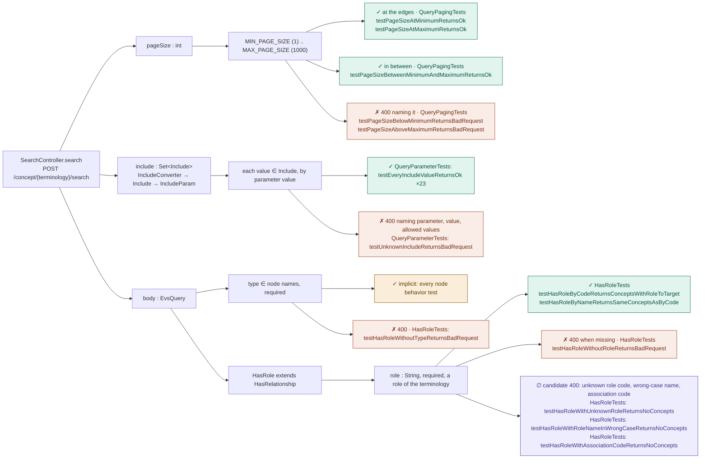

# Contract coverage map

Produces one Mermaid `flowchart LR` showing, for one endpoint, every input contract (a restriction on
an input's domain) and the tests that prove it, laid out along the classes the request actually flows
through. It's a reading aid: surface only the important contracts, using the real class and test names.

## What counts as a contract

A rule about what an input may be, and what happens otherwise:

- **Domain**: type, required/optional, allowed values (enum membership), ranges (`1..1000`), format.
- **Cross-field**: e.g. `fromRecord + pageSize ≤ window`.
- **Inherited from a lower layer**: a limit of a subsystem limits every caller above it (search
  server limits, JSON parser depth, a cap a node enforces). Draw it where it's owned, hanging off the
  input it constrains.
- **Matching semantics callers rely on**: exact vs. case-insensitive, "unknown value returns empty,
  not an error" (see **Matches nothing** below), "both conditions must hold on the same entry".
- **Error shape**: status code, and whether the message names the field, value, and allowed values.

Leave out implementation details (helper methods, internal fields) and data-integrity issues that
aren't contracts, e.g. "needs a reindex for this mapping".

## Four kinds of test

| Kind | Question it answers | Example |
|---|---|---|
| **Accepts** | Is a value inside the domain let through? | `pageSize` 1000 → not a 400 |
| **Rejects** | Is a value outside the domain refused, with the right error? | `pageSize` 1001 → 400 naming `pageSize` |
| **Matches nothing** | Is a value let through that can only ever return no results? | role `R999` (no such role) → 200, no concepts |
| **Behavior** | Given valid input, are the results right? | role R101 → target FK21 returns exactly those concepts |

Accepts, rejects, and matches-nothing together pin down a domain, so they share the contract map.
Behavior isn't about the input domain; it's about what the code does, so it gets its own map.

**Matches nothing is not the same as accepts.** An empty result can mean two very different things:

- **Doesn't match**: the value is valid and could match, but no data matches it right now, e.g. a
  real role that no concept has. That's ordinary behavior; it belongs in the behavior map.
- **Doesn't match and shouldn't match**: the value can never match, because it isn't in the domain at
  all: an unknown role code, a name in the wrong case when names are case-sensitive, an association
  code given as a role, a target from another terminology. The endpoint let bad input through and
  answered with an empty result instead of an error.

Only the second kind goes in the contract map, as its own node, so a silent empty never reads as
coverage. Label each one with one of these verdicts:

- **∅ empty by design**: there's a documented reason not to reject: the spec, the API docs, a
  Javadoc, or the test's own comment says it's "not an error", or checking would cost a lookup the
  endpoint deliberately avoids. Name the source in the label (`∅ by design (spec)`).
- **∅ candidate 400**: nothing documents why, and the value could be checked against something the
  service already knows (the terminology's roles, associations, or loaded terminologies). That's an
  open question for the user, so it has to show on the map. Never resolve it by guessing: if you
  can't find a documented reason, it's a candidate.

**Acceptance tests are explicit, even when behavior tests already send valid input.** Every behavior
test passes some valid value, so "valid input is accepted" is technically covered already. But that
coverage is invisible: a reader can't see it, and deleting a behavior test silently leaves the domain
without its test. A domain edge isn't tested until both sides are: a check written as `≥` instead of
`>` passes every rejection test. Acceptance tests are cheap (status checks only) and cover each
range in two ways:

- **At the edges**: the smallest and largest valid value, and each form a value can take.
- **In between**: one ordinary value well inside the range, e.g. `testPageSizeBetweenMinimumAndMaximumReturnsOk`
  with a page size of 50. Edges alone can pass while the middle is broken (an `==` check where a
  range was meant), and a typical value is what clients actually send.

When writing tests for a range, add the in-between test alongside the edge tests. In the map, a side covered only
by behavior tests is drawn `✓ implicit` so it reads as a gap to close, not as coverage.

In test classes, keep each contract's accepts and rejects tests side by side under one section
heading per contract, mirroring the map; behavior tests go under their own heading.

## Steps

1. **Find the endpoint's signature** in its controller: path variables, request parameters, headers,
   body type. Note declared constraints (`@NotNull`, `@Min`, `@Max`, `@Valid`, `defaultValue`).
2. **Follow each input down the call stack** and collect where it's constrained: converters, model
   `validate()` methods, enum types, node classes, services, and the server/library limits they
   depend on. Read the code; don't infer contracts from names.
3. **Find the tests for each contract.** Search test classes for the input name, the constant, and
   the error text. Read test names and their assertions to confirm what each actually checks. Count
   parameterized tests per case (`×19` for an `@EnumSource` over 19 values).
4. **Mark gaps**: a side (accepts or rejects) with no test gets a `no test` node styled `gap`; one
   covered only by behavior tests gets a `✓ implicit` node styled `implicit`.
5. **Find the matches-nothing cases**: for each input whose value is compared against data (codes,
   names, types), check what an out-of-domain value does. If it's a 200 with no results, find the
   test that pins it (often named `...ReturnsNoConcepts`/`...ReturnsEmpty`), look for a documented
   reason, and give it an `∅` node with its verdict. An out-of-domain value with neither an error nor
   a test pinning the empty result is a `no test` gap on the rejects side.
6. **Write the diagram** in the layout below, then one or two sentences after it naming the gaps,
   where their tests would go, and each `∅ candidate 400` as a question to decide. Don't restate the
   diagram in prose.
7. **Open it rendered on kroki.io** in the built-in browser pane: save the source to a scratchpad
   `.mmd` file, encode it as `https://kroki.io/mermaid/svg/` + base64url(zlib deflate, level 9), check
   the URL returns 200 (400 means a Mermaid syntax error), then navigate to it. Keep the fenced
   source in the reply too.

## Layout

- Root node: `Controller.method` with HTTP method and path.
- One edge per input to an input node: `name : Type`.
- Under each input, the classes it passes through as nodes (`IncludeConverter`, `Include enum`,
  `HasRole extends HasRelationship`), mirroring the real hierarchy.
- Under each class or input, one node per contract, phrased as the rule alone:
  `≤ MAX_RESULT_WINDOW (300,000)`. Use the real constant name and its value.
- Each contract gets two children, which together pin down the domain (plus a third, `∅`, when an
  out-of-domain value gets an empty result instead of an error):
  - **✓ accepts**: tests that values inside the domain get through. For a range, split it into two
    nodes, both styled `accepts`: `✓ at the edges` (smallest and largest valid value, each form a
    value can take) and `✓ in between` (an ordinary value well inside). A range missing its
    in-between test gets a `no test` node styled `gap` in its place. Status checks are enough.
  - **✗ rejects**: tests that values outside get the right error, with the failure in the label
    (`✗ 400 naming it`).
  Each child lists `TestClass: testMethod` lines, owner-level tests before endpoint tests. A side
  covered only incidentally by behavior tests is `✓ implicit: ...`, styled `implicit`, not counted as
  covered. A side with no test at all is `no test`, styled `gap`.
  - **Every implicit node names what covers it and why.** List the covering test(s) as
    `TestClass: testMethod`, then say in a few words how that test exercises this side, e.g.
    `sends a valid role by code and gets results, so the role was accepted`. A reader should never
    have to guess which test stands in for the missing one.
  - **When the gap can't be closed, say so and don't style it as a gap.** If a stricter limit makes
    the side impossible to test on its own (e.g. nothing between JSON nesting 11 and 1,000 can pass,
    because the depth limit of 10 runs first), label it `✓ covered by <test>: <reason>` and style it
    `accepts`. Keep `implicit` (amber) for sides an explicit test could still cover.
  - **∅ matches nothing**: tests that an out-of-domain value returns no results instead of an error,
    labeled with the verdict and what the value was (`∅ candidate 400: unknown role code`,
    `∅ by design (spec): wrong-case name`). Never put these under ✓ accepts.
- Behavior tests (given valid input, are the results right: matches, doesn't match, composes) don't
  go in this map. Draw them as a second map, per node, so they stay easy to find.
- Group sections with `%%` comments: request parameters, each complex parameter, body, each node
  type, server limits.
- Shorten test class names by dropping a shared prefix only if it's unambiguous (e.g.
  `SearchControllerQueryLimitsTests` → `QueryLimitsTests`).
- Color the test nodes (see Colors).

## Colors

Color only the test nodes; leave the input, class, and contract nodes plain so the colors read as
coverage. Put the `classDef` lines and one `class` line per style at the end of the diagram.

Contract map:

| Style | Meaning |
|---|---|
| `accepts` (teal) | ✓ an explicit acceptance test |
| `rejects` (coral) | ✗ a rejection test |
| `implicit` (amber) | ✓ covered only by behavior tests: a gap to close |
| `gap` (red) | no test at all |
| `emptyByDesign` (blue) | ∅ out-of-domain value returns no results, on purpose, with a documented reason |
| `candidate` (purple) | ∅ out-of-domain value returns no results, with no documented reason: decide whether it should be a 400 |

```
classDef accepts fill:#E1F5EE,stroke:#0F6E56,color:#085041;
classDef rejects fill:#FAECE7,stroke:#993C1D,color:#712B13;
classDef implicit fill:#FAEEDA,stroke:#854F0B,color:#633806;
classDef gap fill:#FCEBEB,stroke:#A32D2D,color:#791F1F;
classDef emptyByDesign fill:#E6F1FB,stroke:#185FA5,color:#0C447C;
classDef candidate fill:#EEEDFE,stroke:#534AB7,color:#3C3489;
class TERM1A,PS1A accepts;
class TERM1R,PS1R rejects;
class B1A implicit;
class HR1E candidate;
```

Behavior map: plain for well-covered nodes (matches, doesn't match, composes, each with exact
results), and:

| Style | Meaning |
|---|---|
| `thin` (amber) | a single behavior test, or only contains-style checks on changing data |
| `broken` (red) | behavior tests that currently fail, with the reason in the label |

```
classDef thin fill:#FAEEDA,stroke:#854F0B,color:#633806;
classDef broken fill:#FCEBEB,stroke:#A32D2D,color:#791F1F;
```

## Mermaid pitfalls

- Quote every label: `ID["label"]`.
- Escape `<` and `>` in labels as `&lt;` and `&gt;` (e.g. `Set&lt;Include&gt;`); `<br/>` is the only
  raw tag.
- `{`, `}`, `(`, `)` and `≤` are fine inside quoted labels.
- Keep node IDs short and unique (`HR1`, `HR1T`).

## Example (excerpt)


